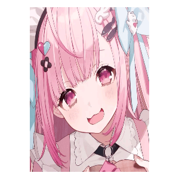

  

  <h1>Hewwo, I'm Chiina! ฅ(ᵔ꒳ᵔマ.ᐟ</h1>

  
<i>Adding more bugs to fix later.</i>

  
  

## 🎀 A little about me

Hi! I'm **Chiina** (aka Salada), a hobbyist developer who enjoys turning oddly specific ideas into software :P

I've been fascinated by the concept of artificial intelligence since I was a kid. While I'm not a fan of AI slop, I think it's incredible how far this technology has come and what vibe coding has made possible :D

I started my programming journey at the age of 13, with **C++** as my first programming language!
Though nowadays, I can't remember a thing... (ᵕ—ᴗ—)

- ⚓ I also love **Minato Aqua**, and that will never change. <3
- 💿 I'm a Sonic fan (Sonic CD 🔛🔝) and an osu! addict!

## 🥞 My little toolbox

## 💫 Learning & exploring

---

  You can do anything!

